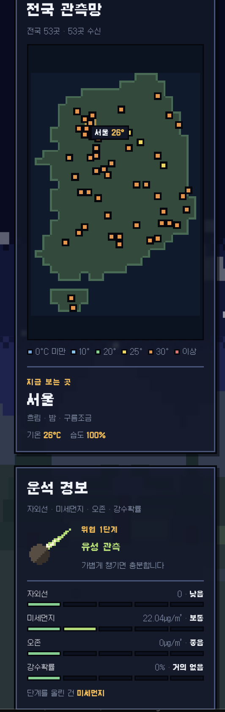
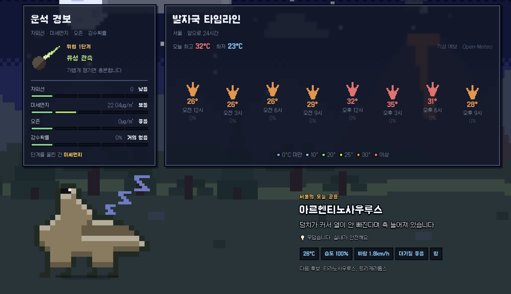
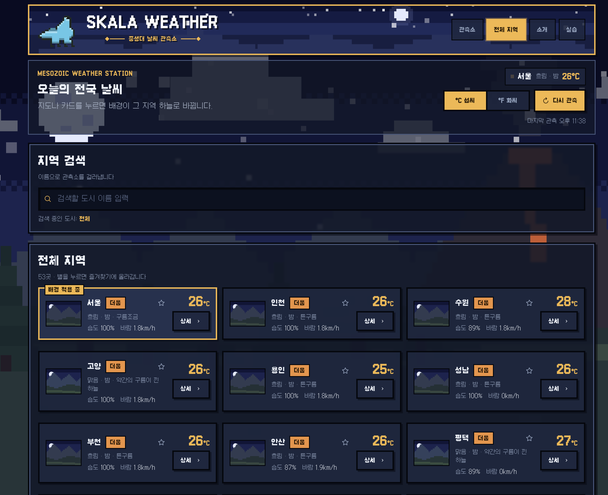

# SKALA WEATHER — 중생대 날씨 관측소

전국 53개 시·군의 실시간 날씨를 받아, **화면 배경과 마스코트 공룡이 함께 바뀌는** Vue 3 대시보드입니다.
SKALA Vue 과제 1~8을 하나의 코드베이스로 계속 업그레이드하며 만들었습니다.

> 기온·습도·풍속 같은 숫자를 읽는 대신, **하늘을 보면 날씨를 아는** 경험을 목표로 했습니다.
> 비가 오면 배경에 비가 내리고 공룡이 우산을 쓴 채 웅크리며, 밤이 되면 별이 뜨고 공룡이 졸기 시작합니다.

🔗 배포 주소 — https://skala-vue-beta-three.vercel.app
📁 저장소 — https://github.com/boboinhaco/skala-vue  (Public)

| 메인 대시보드                     | 전국 지도 · 운석 경보            |
| --------------------------------- | -------------------------------- |
|  |  |

| 발자국 타임라인 · 공룡 마스코트       | 상세 페이지                         |
| ------------------------------------- | ----------------------------------- |
|  |  |


---

## 목차

1. [실행 방법](#실행-방법)
2. [배포](#배포)
3. [과제 요구사항 대비 구현](#과제-요구사항-대비-구현)
4. [단원별 Customization 내역](#단원별-customization-내역)
5. [기술 스택과 선택 이유](#기술-스택과-선택-이유)
6. [직접 만든 기능](#직접-만든-기능)
7. [프로젝트 구조](#프로젝트-구조)
8. [404 및 예외 처리 설계](#404-및-예외-처리-설계)
9. [과제 요구사항 대비 변경 사항 기록](#과제-요구사항-대비-변경-사항-기록)
10. [과제 산출물 보존 정책](#과제-산출물-보존-정책)
11. [트러블슈팅](#트러블슈팅)
12. [커밋 컨벤션](#커밋-컨벤션)
13. [사용 리소스와 라이선스](#사용-리소스와-라이선스)

---

## 실행 방법

```sh
npm install
npm run dev      # 개발 서버
npm run build    # 프로덕션 빌드
npm run lint     # ESLint + oxlint (오류 0 유지)
npm run format   # Prettier
npm run sprites  # art/dino-src 원화 → public/dinos @2x 스프라이트 재생성
```

### 환경 변수

프로젝트 루트에 `.env.local`을 만들고 아래 값을 채웁니다.

```env
VITE_OPENWEATHER_API_KEY=발급받은_OpenWeather_키
VITE_PRIMEUI_LICENSE=발급받은_PrimeUI_키
```

`.gitignore`의 `*.local` 규칙으로 무시되며, 저장소에 커밋된 적이 없습니다.
확인은 `git ls-files | grep env`로 했고 결과가 비어 있습니다. (과제 8-2)

> 다만 `.env`로 뺀다고 키가 숨겨지는 건 아니라는 걸 나중에 알았습니다.
> `VITE_` 접두사가 붙은 변수는 **빌드할 때 값이 그대로 번들에 박혀서** 개발자도구에서 보입니다.
> 저장소에 안 올라간다는 것뿐이지 완전한 은닉은 아니고, 실제 서비스라면 프록시 서버를 두거나
> API 쪽에서 도메인 제한을 걸어야 한다고 합니다. 과제 범위에서는 여기까지만 처리했습니다.

---

## 배포

**Vercel**로 배포했습니다.

### 왜 Vercel인가

네 군데를 놓고 비교했습니다.

|                       | Vercel          | Netlify         | Cloudflare Pages | GitHub Pages       |
| --------------------- | --------------- | --------------- | ---------------- | ------------------ |
| Vite 프리셋 자동 인식 | ✅              | ✅              | ⚠️ 수동 선택     | ❌ 워크플로 작성   |
| push 시 자동 배포     | ✅              | ✅              | ✅               | ⚠️ Actions 필요    |
| PR별 프리뷰 URL       | ✅              | ✅              | ✅               | ❌                 |
| 환경 변수 관리 UI     | ✅              | ✅              | ✅               | ❌                 |
| SPA 새로고침 404      | ⚠️ rewrite 설정 | ⚠️ `_redirects` | ✅ 기본 지원     | ⚠️ `404.html` 우회 |

**GitHub Pages는 바로 뺐습니다.** 배포 주소가 `계정명.github.io/저장소명/` 형태라
`vite.config.js`의 `base`랑 라우터 설정을 둘 다 맞춰야 하는데, 이번 과제가 라우팅을 배우는 건데
라우팅 설정이랑 싸우게 될 것 같았습니다.

Cloudflare Pages는 SPA 404를 설정 없이 처리해주는 게 매력적이었는데,
막혔을 때 참고할 한국어 자료가 Vercel 쪽이 훨씬 많아서 **막힐 확률이 낮은 쪽**으로 골랐습니다.
배포는 이번 과제의 평가 대상이 아니라 "되기만 하면 되는" 영역이라고 판단했습니다.

새 버전이 완전히 준비된 다음에 한 번에 넘어가는 방식이라,
배포 도중에 반쯤 깨진 화면이 보이는 일이 없습니다. 이걸 atomic deployment라고 부른다고 합니다.

**이건 Vercel만의 기능이 아니라 Netlify, Cloudflare Pages도 똑같습니다.**
셋 다 "대표 주소 + 배포별 개별 주소" 구조를 쓰고, push하면 대표 주소가 최신으로 넘어갑니다.

|                      | 대표 주소                | 개별 배포 주소                   |
| -------------------- | ------------------------ | -------------------------------- |
| **Vercel**           | `프로젝트명.vercel.app`  | `프로젝트-해시-팀명.vercel.app`  |
| **Netlify**          | `프로젝트명.netlify.app` | `해시--프로젝트명.netlify.app`   |
| **Cloudflare Pages** | `프로젝트명.pages.dev`   | `해시.프로젝트명.pages.dev`      |

GitHub Pages만 조금 다른데, 주소가 하나뿐이라 **개별 배포 주소가 없고 이전 버전으로 되돌릴 수도 없습니다.**
나머지 셋은 대시보드에서 클릭 한 번으로 롤백이 되는데, GitHub Pages는 코드를 되돌려서 다시 push해야 합니다.


### 배포 설정

- Framework Preset: **Vite** (자동 인식)
- Root Directory: **저장소 루트** — 앱이 루트에 있어 따로 지정할 필요가 없습니다
- Environment Variables: `VITE_OPENWEATHER_API_KEY`, `VITE_PRIMEUI_LICENSE`
- [`vercel.json`](./vercel.json)에 rewrite 규칙 추가

```json
{ "rewrites": [{ "source": "/(.*)", "destination": "/index.html" }] }
```

Vercel 프리셋이 알아서 해준다는 얘기도 있었지만, 설정을 코드로 남겨두면 프리셋이 바뀌어도
안전할 것 같아서 파일로 명시했습니다. (이게 왜 필요한지는 [404 설계 ②번](#-새로고침직접-접속--서버가-regions를-모르는-문제) 참고)

### 환경 변수 등록 후 재배포 필요

Vite는 빌드 시점에 환경 변수를 코드에 박아 넣기 때문에,
Vercel 대시보드에 변수를 추가만 하고 재배포를 안 하면 기존 빌드에는 반영되지 않습니다.
처음에 이걸 몰라서 배포본에만 PrimeUI 배너가 남아 있었습니다.

---

## 과제 요구사항 대비 구현

> 요구사항 문구를 강의자료 그대로 옮기고, 실제 구현 위치를 링크로 연결했습니다.


### 과제 1 — Weather Mockup

| 요구사항                                        | 구현 위치                                                    | 메모                                                                      |
| ----------------------------------------------- | ------------------------------------------------------------ | ------------------------------------------------------------------------- |
| 배열 렌더링 (v-for), `:key`에 id 바인딩         | [`ObservatoryList.vue`](링크) · [`PixelKoreaMap.vue`](링크)  | 도시 고유 id를 key로                                                      |
| 조건부 렌더링 (v-if) 기온 라벨                  | [`WeatherCard.vue`](링크)                                    | 요구는 2구간이었는데 슈퍼핫/더움/선선함/쌀쌀함 4구간으로 늘렸습니다       |
| 양방향 바인딩 및 한글 처리 (`:value` `@input`)  | [`SearchBar.vue`](링크)                                      | v-model을 쓰면 한글 조합 중에 값이 안 들어와서 요구대로 `:value`+`@input` |
| 카드 클릭 시 상태바에 "{도시}이 선택되었습니다" | [`WeatherHomeView.vue`](링크)                                |                                                                           |
| 상세보기 버튼 → **버블링 없이** `window.alert`  | [`WeatherParent.vue`](링크)                                  | `@click.stop`. 과제 4에서 `router.push`로 교체했고 원본은 보존            |
| 본인만의 데이터 + Mockup 추가                   | [1일차 Customization](#1일차--본인만의-데이터와-mockup-추가) |                                                                           |

### 과제 2 — Weather Composition

| 요구사항                                          | 구현 위치                                                               | 메모                                         |
| ------------------------------------------------- | ----------------------------------------------------------------------- | -------------------------------------------- |
| 반응형 상태 관리                                  | [`weatherStore.js`](링크)                                               | `searchQuery` `selectedCityId` `weatherList` |
| computed 활용 (`filteredWeatherList`)             | [`WeatherHomeView.vue`](링크)                                           | 검색어가 도시명에 포함된 항목만              |
| **watch** — selectedCityInfo 감시 → **콘솔로그**  | [`WeatherParent.vue`](링크)                                             | 상태바 문구 바뀔 때마다 콘솔 출력            |
| **watchEffect** — searchQuery 추적 → **콘솔로그** | [`WeatherParent.vue`](링크)                                             | 타이핑할 때마다 콘솔 출력                    |
| 검색 결과 3분기 표시                              | [`WeatherHomeView.vue`](링크)                                           | 빈 검색어 / 일치 / 불일치 안내               |
| 본인만의 상태·Computed·Watcher 추가               | [2일차 Customization](#2일차--본인만의-반응형-상태computedwatcher-추가) |                                              |

> **확인 방법:** 과제 2에서 요구한 `watch` / `watchEffect` 콘솔로그는 `WeatherParent.vue`에
> 그대로 살아 있고, **`/practice` 경로에서 실제로 동작합니다.**
> 앱 본화면은 과제 5에서 데이터를 스토어로 옮기면서 `weatherStore`의 `watch`가
> 예보·대기질 재요청을 맡고 있습니다. 두 코드 모두 현재 저장소에 있습니다.

### 과제 3 — Weather Component

| 요구사항                                                                | 구현 위치                                                | 메모                                                       |
| ----------------------------------------------------------------------- | -------------------------------------------------------- | ---------------------------------------------------------- |
| `WeatherParent.vue` — 모든 반응형 데이터 유지                           | [링크](링크)                                             |                                                            |
| `BaseDashboardCard.vue` — **`<slot>`** 배치                             | [링크](링크)                                             | PrimeVue `Card`를 감싸고 `title`/`subtitle`/기본 슬롯 제공 |
| `SearchBar.vue` — props + **`update-query`** emit                       | [링크](링크)                                             |                                                            |
| `WeatherCard.vue` — props + **`select-card`** / **`click-detail`** emit | [링크](링크)                                             |                                                            |
| 각 컴포넌트 **`<style scoped>`** 로 디자인 분리                         | 전 컴포넌트                                              | 공용 토큰만 `pixel.css`, 나머지는 전부 scoped              |
| 본인 Mockup 부분 추가 컴포넌트화                                        | [3일차 Customization](#3일차--추가-컴포넌트와-추가-view) | 지정 4개 외에 **18개 더 분리**                             |

분리하면서 줄어든 줄 수를 재봤습니다.

| 원본                          | 분리 후                                                                 |
| ----------------------------- | ----------------------------------------------------------------------- |
| `PixelWeatherScene.vue` 458줄 | 79줄 + 레이어 4개(하늘/천체/지형/날씨효과)                              |
| `WeatherHomeView.vue` 335줄   | 209줄 + `ObservatoryList` `SelectedSummary`                             |
| `MeteorAlertCard.vue` 219줄   | 86줄 + `MeteorIcon` `IndicatorBar`                                      |
| `AxiosJson.vue` 387줄         | 236줄 + `PostCreateForm` `PostItem` `ApiMessage`                        |
| `App.vue` 253줄               | 34줄 + `SiteHeader` `BrandMark` `MainNav` `WeatherBar` `WeatherNowChip` |

줄 수만 줄인 게 아니라 실제로 재사용되는 것들도 있습니다.
`TempLegend`는 지도와 타임라인이 같이 쓰고, `TemperatureReading`은 4곳에 흩어져 있던 기온 표기를
합친 거고, `ObservatoryList`는 관측소 화면과 전체지역 화면이 공유합니다.

### 과제 4 — Weather Router

| 요구사항                                                      | 구현 위치                 | 메모                                                          |
| ------------------------------------------------------------- | ------------------------- | ------------------------------------------------------------- |
| **지연 로딩** 적용                                            | [`router/index.js`](링크) | 라우트 6개 전부 `() => import()`                              |
| **Catch-all Route** 적용                                      | [`router/index.js`](링크) | `/:pathMatch(.*)*` → `NotFoundView`                           |
| `App.vue` — RouterLink 네비 + RouterView                      | [`App.vue`](링크)         |                                                               |
| `WeatherHomeView` — alert 제거 후 **Programmatic Navigation** | [링크](링크)              | `router.push({ name: 'weather-detail', params: { cityId } })` |
| `WeatherDetailView` — `:cityId` 동적 매칭, Mount 시점 선택    | [링크](링크)              | 진입하면 배경도 그 지역 날씨로 바뀝니다                       |
| `WeatherAboutView` — 내용 작성 + **메인 대시보드로 돌아가기** | [링크](링크)              | 서비스 소개 + 홈 복귀 버튼                                    |
| `NotFoundView`                                                | [링크](링크)              |                                                               |
| **본인 추가 view**                                            | [`RegionsView.vue`](링크) | `/regions` 전체 지역 화면                                     |

### 과제 5 — Weather Store

| 요구사항                                                                    | 구현 위치                                              | 메모                                                                     |
| --------------------------------------------------------------------------- | ------------------------------------------------------ | ------------------------------------------------------------------------ |
| `configStore.js` — state `unit` / getter `unitSymbol` / action `toggleUnit` | [링크](링크)                                           | 초기값 `celsius`                                                         |
| `UnitToggler.vue` 배치                                                      | [`UnitToggle.vue`](링크)                               | PrimeVue `SelectButton`. 위치는 [변경 기록 5번](#5-unittoggle-위치) 참고 |
| 메인과 상세 날씨에 단위 설정 적용                                           | [`useTemperature.js`](링크)                            | 헤더 칩까지 같이 바뀝니다                                                |
| 본인만의 추가 Store                                                         | [`favoriteStore.js`](링크) · [`weatherStore.js`](링크) |                                                                          |

강의자료에 "Composable로 해결 가능함 (범위 제외)"라고 적힌 부분이 있었는데,
메인이랑 상세에 같은 변환 코드를 두 번 쓰는 게 계속 걸려서 `useTemperature`로 빼봤습니다.

### 과제 6 — Weather Axios

| 요구사항                        | 구현 위치                 | 메모                                                                                                       |
| ------------------------------- | ------------------------- | ---------------------------------------------------------------------------------------------------------- |
| OpenWeatherMap 실제 데이터 연동 | [`weatherStore.js`](링크) | Current Weather API — 53개 도시                                                                            |
| OpenWeatherMap **추가** API     | [링크](링크)              | Air Pollution API, 5 day / 3 hour Forecast API                                                             |
| **기타 외부 API** 추가          | [`meteorAlert.js`](링크)  | **Open-Meteo** Air Quality + Forecast ([선정 이유](#4-1-자외선을-추정에서-실측으로-교체--open-meteo-도입)) |

요구사항 외에 추가로 넣은 것들입니다.

- **`Promise.allSettled` 병렬 처리** — 53개를 동시에 던지고, 실패한 도시만 이전 값 유지
- **에러 상태 UI + 재시도 버튼**
- **로딩 상태** — 최초 스피너, 버튼 라벨 "관측 중..." 전환, 중복 요청 차단
- **캐시** — 5분 안에 다시 요청하면 네트워크를 안 탑니다

### 과제 7 — Weather UI Library

PrimeVue 5 적용. [선택 이유](#ui-라이브러리로-primevue를-고른-이유) 참고.

사용한 컴포넌트: `Card` `Button` `InputText` `IconField/InputIcon` `SelectButton` `Tag` `Message`
`ProgressSpinner` `Toast` `Divider`

### 과제 8 — Build & Deployment

| 요구사항                               | 상태                                       |
| -------------------------------------- | ------------------------------------------ |
| ESLint로 Error 0건                     | ✅ `npm run lint` (ESLint + oxlint) 오류 0 |
| API 키 환경 변수 분리, Git 업로드 차단 | ✅ `.env.local` + `*.local` gitignore      |
| Build 후 정적 호스팅                   | ✅ Vercel + `vercel.json`                  |

### 제출 전 확인

- [ ] GitHub **Public** 저장소 여부
- [ ] 시크릿 창(`⌘ + Shift + N`)으로 저장소 접속 → 로그인 없이 소스 보임
- [ ] 배포 URL 정상 동작
- [ ] 상세 페이지에서 새로고침 → 호스팅 404 안 뜸
- [ ] `/asdf` 접속 → 내가 만든 `NotFoundView` 표시
- [ ] 배포 환경 변수 등록 후 재배포 → PrimeUI 배너 없음

---

## 단원별 Customization 내역

> 과제 안내의 "각 단원 별 실습이 진행될 때마다 개인별 Customization 한 내역을 기록한다"에 맞춰
> **어느 단원의 문법으로 만들었는지** 기준으로 나눴습니다.

### 1일차 — 본인만의 데이터와 Mockup 추가

강의 예시 데이터가 `{ id, name, temp, status }` 4개 필드였는데,
공룡 매칭이랑 경보를 만들려면 필드가 더 필요해서 **지역·기온·습도·풍속·자외선·미세먼지·강수확률**로 늘렸습니다.

- **`dinos.json`** — 공룡 9종 + WMO 날씨 그룹 8종. 종별 선호 기온 구간·습도 성향·날씨 코드 정의
- **`weatherScenes.js`** — 날씨별 배경 16종 (8가지 하늘 × 낮/밤)
- **`koreaMap.js`** — 전국 지도 격자 + 위경도 변환 테이블
- **추가 Mockup** — 시도별 관측소 목록, 즐겨찾기 별, 전체 지역 화면, 발자국 타임라인, 공룡 마스코트

### 2일차 — 본인만의 반응형 상태·Computed·Watcher 추가

- **`meteorAlert`** — 자외선·미세먼지·오존·강수확률을 종합해 경보 단계 산출
- **`matchedDino`** — 날씨 조건을 점수로 환산해 9종 중 1종 선택
- **`sceneCode`** — 날씨 + 낮/밤을 배경 16종 중 하나로 매핑
- **`selectedForecast`** — 선택한 도시의 24시간 예보 추출
- **액세서리 배치** — 종별 부착 좌표·머리 비율로 우산/목도리 위치와 크기를 계산
- **즐겨찾기 정렬** — 즐겨찾기를 위로 올리되 원래 순서는 유지
- **watch** — 선택 도시가 바뀌면 예보·대기질 재요청 / 즐겨찾기 바뀌면 localStorage 동기화

### 3일차 — 추가 컴포넌트와 추가 View

- 지정 4개 외에 **18개 추가 분리** (위 표 참고)
- 배경을 레이어 4종(하늘/천체/지형/날씨효과)으로 쪼개서 조합 가능하게 만듦
- **추가 View** — `/regions` 전체 지역 화면

### 4일차 — 추가 Store와 외부 API

- **`favoriteStore`** — 즐겨찾기 + localStorage 영속
- **`weatherStore`** — 53개 도시 · 예보 · 대기질 통합
- **`useTemperature`** · **`useCitySelection`** 컴포저블
- **Open-Meteo** — OpenWeatherMap 외 기타 외부 API

---

## 기술 스택과 선택 이유

| 구분              | 선택                     | 이유                                 |
| ----------------- | ------------------------ | ------------------------------------ |
| 프레임워크        | Vue 3 (`<script setup>`) | 과제 지정                            |
| 상태 관리         | Pinia                    | 과제 지정. Setup Store 문법으로 통일 |
| 라우팅            | Vue Router (지연 로딩)   | 과제 지정                            |
| HTTP              | Axios                    | 과제 지정. 아래 따로 정리            |
| **UI 라이브러리** | **PrimeVue 5**           | 아래 따로 정리                       |
| 폰트              | Galmuri (OFL-1.1)        | 한글 지원되는 픽셀 폰트              |

### UI 라이브러리로 PrimeVue를 고른 이유

처음엔 shadcn/ui가 예뻐 보여서 그걸 쓰려고 했는데, 찾아보니 **shadcn/ui랑 Radix UI는 React 전용**이었습니다.
Vue 쪽 대응은 shadcn-vue랑 Reka UI(예전 Radix Vue)인데, 이건 **npm 의존성이 아니라 소스를 복붙하는 방식**이고
**Tailwind가 깔려 있어야** 돌아갑니다. 지금 프로젝트에 Tailwind가 없어서, 라이브러리 하나 넣는 게 아니라
기반 스택을 통째로 얹는 일이 될 것 같아 4일 일정에는 무리라고 판단했습니다.

그래서 픽셀아트 테마를 만들기 유리한 쪽으로 다시 골랐고, PrimeVue가 세 가지 이유로 맞았습니다.

**1. 디자인 토큰으로 테마를 통째로 덮어쓸 수 있습니다**

픽셀 UI에서 제일 중요한 건 "둥근 모서리가 하나도 없을 것"인데,
컴포넌트마다 `border-radius: 0`을 찾아다니는 대신 `definePreset()`으로 토큰 한 곳만 바꾸면 끝이었습니다.

```js
// src/main.js
const PixelPreset = definePreset(Aura, {
  primitive: { borderRadius: { none: '0', xs: '0', sm: '0', md: '0', lg: '0', xl: '0' } },
  semantic: { primary: {/* 용암색 계열 팔레트 */} },
})
```

**2. `cssLayer` 옵션 덕분에 `!important` 싸움이 없었습니다**

라이브러리를 커스터마이징할 때 제일 귀찮은 게 스타일 덮어쓰기인데,
PrimeVue는 자기 스타일을 CSS `@layer` 안에 넣는 옵션이 있었습니다.
**레이어 안에 들어간 규칙은 레이어 밖의 일반 규칙한테 무조건 집니다.**
그래서 `pixel.css`가 특이도를 억지로 올리지 않아도 항상 이깁니다.

```js
theme: { preset: PixelPreset, options: { cssLayer: { name: 'primevue', order: 'primevue' } } }
```

**3. Element Plus와 같이 쓸 수 있었습니다**

과제 3~5 시점 실습 코드가 Element Plus를 쓰고 있었는데,
클래스 이름이 `.el-*` / `.p-*`로 갈려 있어서 **실습 코드를 그대로 두고** 앱 화면만 옮길 수 있었습니다.
실습 페이지의 Element Plus 컴포넌트는 `--el-*` CSS 변수를 덮어써서 같은 픽셀 테마로 맞췄습니다.

> **작업 중에 알게 된 것:** PrimeVue 5부터는 MIT가 아니라 **PrimeUI 라이선스**입니다(4.5.5까지 MIT).
> 키가 없으면 화면에 `Invalid PrimeUI License` 배너가 뜹니다.
> 자세한 대응은 [변경 기록 8번](#8-primevue-5-라이선스-전환) 참고.

### 사용한 외부 API

| API                     | 제공처         | 쓰는 곳                   | 키     |
| ----------------------- | -------------- | ------------------------- | ------ |
| Current Weather         | OpenWeatherMap | 53개 도시 현재 날씨       | 필요   |
| Air Pollution           | OpenWeatherMap | 미세먼지(PM2.5)           | 필요   |
| 5 day / 3 hour Forecast | OpenWeatherMap | 발자국 타임라인, 강수확률 | 필요   |
| Air Quality             | **Open-Meteo** | **자외선 실측, 오존**     | 불필요 |
| Forecast (daily)        | **Open-Meteo** | **오늘 최고/최저 기온**   | 불필요 |

OpenWeather는 **분당 60회** 제한이 있어서 도시 수만큼만 쓰고(53회),
나머지는 보고 있는 지역 한 곳만 요청합니다.
Open-Meteo는 키가 없고 CORS가 열려 있어서 브라우저에서 바로 부릅니다.

### Axios를 쓰는 이유 (fetch와 뭐가 다른지)

과제 지정이긴 한데, 브라우저에 `fetch`가 이미 있는데 왜 쓰는지 궁금해서 찾아봤습니다.

**① 에러 판정 기준이 다릅니다**

`fetch`는 404나 500이 와도 "요청 자체는 성공"으로 보고 `resolve`합니다.
그래서 매번 `response.ok`를 직접 확인해야 하는데, Axios는 2xx를 벗어나면 `reject`라
`try/catch` 한 곳에서 잡힙니다. 도시 53개를 동시에 던지는 구조라 이게 편했습니다.

```js
// 실패한 도시만 이전 데이터를 유지하고 나머지는 정상 표시
const results = await Promise.allSettled(CITIES.map((city) => axios.get(API_URL, { params })))
```

**② 응답 파싱이 한 단계 적습니다** — `res.json()` 없이 `res.data`로 바로 갑니다.

**③ `params` 객체로 쿼리스트링을 만듭니다** — 위경도·키·단위·언어를 문자열로 이어붙이면
오타나 인코딩 실수가 나기 쉬운데, 객체로 넘기면 알아서 만들어줍니다.

---

## 직접 만든 기능

### 1. 즐겨찾기

도시 카드의 별을 누르면 **빈 별 ☆ → 노란 별 ★**로 바뀌고, 관측소 목록 **맨 위로 올라옵니다.**

- `favoriteStore` + **localStorage 영속** — 새로고침해도 유지
- 즐겨찾기끼리는 원래 목록 순서 유지 (누른 순서로 뒤섞이면 찾기 힘들어서)
- 전체 지역 화면에서는 "즐겨찾기 / 그 밖의 지역" 두 묶음으로 분리
- `aria-pressed`로 상태를 보조기기에 전달

### 2. 시도별 관측소 + 전체 지역 화면

관측소 카드에는 지역별 **기온 · 습도 · 풍속**이랑 그 지역 하늘의 축소 미리보기가 같이 나옵니다.
메인에는 **6곳만** 보여주고 나머지는 **"더보기"** 로 넘어갑니다.

> **이 전환은 서버에 새 페이지를 요청하는 게 아닙니다.**
> Vue Router의 클라이언트 사이드 라우팅이라 `router.push`가 실행되면
> **브라우저 새로고침 없이 컴포넌트만 갈아끼워집니다.**
> URL은 `/regions`로 바뀌고 뒤로가기도 되지만, 실제로는 SPA 안에서 화면만 바뀌는 거였습니다.
> 게다가 이 화면은 `() => import()` 지연 로딩이라 처음 들어가기 전까지는 코드를 받지도 않습니다.

지도에서 고른 지역이 접힌 목록에 없으면 **맨 앞에 끼워 넣어서** 항상 보이게 했습니다.

### 3. 운석 경보 시스템

**자외선 · 미세먼지 · 오존 · 강수확률**을 각각 5단계로 매기고,
**가장 나쁜 지표가 경보 단계를 정합니다.** 실제 기상 경보도 이렇게 한다고 해서 따라 했습니다.

```
평온한 하늘 → 유성 관측 → 운석 접근 → 궤도 진입 → 대멸종 경보
```

- 등급 기준은 **국내 예보 기준** 그대로 썼습니다
  (PM2.5 15/35/75/150 ㎍/㎥, 자외선 2/5/7/10, 오존은 1시간 기준 0.030/0.090/0.150 ppm을 ㎍/㎥로 환산)
- 픽셀 운석 아이콘의 불꽃 색이 단계에 따라 바뀌고, 단계를 올린 원인 지표를 같이 보여줍니다
- **강수확률만 3단계까지로 상한을 뒀습니다.**
  처음엔 다른 지표랑 똑같이 5단계로 했는데, 비 좀 온다고 "대멸종 경보"가 뜨니까 너무 과했습니다.
  비는 불편한 거지 위험한 게 아니라서 상한을 걸었습니다

**자외선은 Open-Meteo 실측값을 쓰고, 못 받으면 계산으로 추정합니다.**

OpenWeather 무료 키로는 자외선을 못 받습니다(One Call 3.0이 유료라 401이 떴습니다).
그래서 처음엔 **태양 고도각 + 구름 감쇠** 물리식으로 직접 계산하고 `추정` 배지를 달았는데,
나중에 Open-Meteo를 붙이면서 **실측값이 오면 그걸 쓰고 배지를 떼도록** 바꿨습니다.
Open-Meteo 요청이 실패하면 추정 로직이 그대로 대신하니까 화면이 비지는 않습니다.

내가 만든 추정이 얼마나 맞았는지도 비교해봤습니다.

```
서울 8월 기준
  내 추정      태양고도 62.5° → UV 9.4
  Open-Meteo 실측 최고        → UV 8.35   (약 12% 높게 나옴)
```

### 4. 발자국 타임라인

**앞으로 24시간(3시간 간격 8칸) 기온 변화를 공룡 발자국으로 그린 그래프**입니다.

- 발자국 **색이 곧 기온**입니다 (0°C 미만 파랑 → 30°C 이상 빨강, 지도 범례와 같은 눈금)
- 좌우 발을 번갈아 디딘 것처럼 **위아래로 어긋나고 좌우 반전**돼서 실제로 걸어간 자국처럼 보입니다
- 강수확률 30% 이상인 시간대에는 발자국 위에 빗방울을 찍었습니다
- 발자국 모양은 수각류 발자국을 참고해서 16×16 격자에 직접 그렸습니다
- 상단에 **Open-Meteo 예보 기준 오늘 최고/최저 기온**을 같이 표시합니다

### 5. 날씨에 맞는 공룡 마스코트

**그날 그 지역 날씨에 제일 어울리는 공룡을 9종 중에서 골라줍니다.**

점수 계산: `날씨 코드 일치(40점) + 기온 구간(30점) + 습도 성향(15점) + 바람 조건(±15점) + 우선순위`

점수제로 만든 이유는, 어떤 날씨가 와도 **무조건 한 마리는 뽑히게** 하기 위해서였습니다.
조건문으로 하면 애매한 날씨에서 아무도 안 나와서 화면이 비었습니다.

- 비 오면 스피노사우루스(물가 체질), 눈 오면 안킬로사우루스(갑옷) 같은 식으로
  **실제 고생물학적 특징**을 근거로 매칭했습니다
- 공룡 9종은 **96×72 픽셀 스프라이트**로 직접 그렸고, 날씨 소품만 SVG 도트로 위에 얹습니다
- 원화가 축소본이라 3배로 키우니 축소 과정의 잡티가 블록으로 드러났습니다
  (불투명 픽셀 2,600개에 고유색이 2,300개 — 사실상 픽셀마다 색이 달랐습니다)
  → **48색으로 정리하고 EPX로 2배 확대한 @2x 에셋**으로 교체했습니다.
  좌표계는 96×72 그대로라 코드는 안 건드렸고, 색이 줄어서 용량은 오히려 **40% 줄었습니다**
- 색 수는 28·48·64·96으로 비교해서 골랐습니다. 28색은 티라노 혀가 사라지고 96색은 잡티가 남습니다
- 원화와 변환 스크립트를 `art/`에 두고 `npm run sprites`로 다시 뽑을 수 있게 했습니다.
  Node 내장 zlib만 쓰고 의존성이 없으며, 끝나면 종별 발끝 여백을 재서
  `dinoSprites.js`의 `foot` 값과 어긋나는지 알려줍니다 — 원화를 더 큰 해상도로
  다시 넣어도 그대로 돌아갑니다
- 날씨에 따라 **우산·선글라스·마스크·목도리·방한모**를 쓰고 **몸짓도 바뀝니다**
  (4°C 이하 덜덜 떨기 / 32°C 이상 헐떡이기 / 비 오면 웅크리기 / 바람 30km/h 이상 기울이기 / 밤에는 졸기)
- 소품 위치는 종마다 **눈·주둥이·목·머리 꼭대기 좌표**를 잡아두고,
  **머리 크기 비율(headScale)**로 크기를 맞춥니다 — 브라키오사우루스와 티라노사우루스는
  머리 크기가 2배 넘게 차이나서 같은 모자를 그대로 쓰면 한쪽은 안 맞습니다
- 배경 위를 **왼쪽에서 가운데까지 걸어갔다 돌아오고**, 끝에 닿으면 몸을 돌립니다
- 발밑 그림자는 스프라이트마다 다른 **발끝 여백(foot)**을 계산해서 붙입니다
  (고정값으로 했더니 안킬로사우루스는 10px 떠 있었습니다)

### 6. 픽셀 배경과 전국 지도

- **날씨별 배경 16종** (8가지 하늘 × 낮/밤). 지도나 카드를 누르면 **0.75초 크로스페이드**로 넘어갑니다
- 중생대 풍경으로 맞췄습니다 — 화산(용암·분연), 계단형 산맥, 침엽수·소철·양치식물
- **전국 지도**는 남한 지형을 격자에 직접 그리고, **위경도 → 격자 좌표 변환**으로 53개 마커를 찍었습니다
- 마커 색이 기온이라 **지도만 봐도 어디가 덥고 추운지** 보입니다
- 헤더 배너 풍경은 **태양 고도로 판정한 실제 낮/밤**을 따라갑니다

---

## 프로젝트 구조

```
art/                             # ★ 원화와 에셋 빌드 (번들에 안 들어감)
├── dino-src/                    #   공룡 9종 원화 96×72
└── build-sprites.mjs            #   48색 정리 + EPX 2배 → public/dinos (의존성 없음)

public/
└── dinos/                       # 공룡 9종 스프라이트 (96×72 좌표계 · 192×144 @2x PNG)

src/
├── main.js                      # Pinia · Router · PrimeVue(픽셀 프리셋) 주입
├── App.vue / App.css            # 배경 · 헤더 · RouterView 조립 (34줄)
├── router/index.js              # 지연 로딩 + Catch-all
│
├── views/                       # 페이지 단위
│   ├── WeatherHomeView.vue      # 메인 대시보드
│   ├── RegionsView.vue          # ★ 추가 View — 전체 지역
│   ├── WeatherDetailView.vue    # /weather/:cityId
│   ├── WeatherAboutView.vue     # 서비스 소개
│   ├── NotFoundView.vue         # Catch-all
│   └── PracticeView.vue         # 강의 실습 모음 (보존)
│
├── stores/
│   ├── weatherStore.js          # ★ 53개 도시 · 예보 · 대기질
│   ├── favoriteStore.js         # ★ 즐겨찾기 (localStorage 영속)
│   ├── configStore.js           # 온도 단위 (과제 5)
│   └── counter.js               # 강의 기본 스토어 (보존)
│
├── composables/
│   ├── useTemperature.js        # 단위 변환 (메인/상세 중복 제거)
│   └── useCitySelection.js      # ★ 도시 선택 동작 공유
│
├── data/                        # ★ 순수 데이터 · 계산 로직 (UI 없음)
│   ├── dinos.json               #   공룡 9종 + WMO 날씨 그룹 8종
│   ├── dinoSprites.js           #   96×72 스프라이트 메타 · 액세서리 도트맵
│   ├── matchDino.js             #   날씨 → 공룡 매칭 점수 계산
│   ├── weatherScenes.js         #   배경 화면 16종 (8날씨 × 낮/밤)
│   ├── koreaMap.js              #   전국 지도 격자 + 위경도 변환
│   ├── meteorAlert.js           #   ★ 운석 경보 계산 + 자외선 fallback
│   ├── openWeatherToWmo.js      #   OpenWeather → WMO 코드 어댑터
│   └── tempScale.js             #   기온 색 눈금 (지도/타임라인 공유)
│
└── components/
    ├── DinoMascot.vue           # ★ 공룡 스프라이트 + 날씨 액세서리 · 몸짓
    ├── layout/                  # 헤더 배너 · 메뉴 · 관측 막대
    ├── scene/                   # 픽셀 배경 · 지도 · 경보 · 발자국
    │   └── layers/              #   배경 레이어 4종
    ├── exercise/                # 과제 3 지정 컴포넌트 + 확장
    ├── common/                  # 즐겨찾기 별 · 기온 표기
    └── practices/               # 강의 실습 컴포넌트 (보존)
```

`.vue` 파일은 65개고, 역할별 폴더로 나눴습니다.

---

## 404 및 예외 처리 설계

만들다 보니 "없는 것"에 종류가 세 가지나 있어서 각각 다르게 처리했습니다.

### ① 없는 경로 — `/asdf`

Vue Router의 **Catch-all**이 잡아서 `NotFoundView`로 보냅니다.

```js
{ path: '/:pathMatch(.*)*', name: 'not-found', component: () => import('../views/NotFoundView.vue') }
```

### ② 새로고침·직접 접속 — 서버가 `/regions`를 모르는 문제

이건 배포하고 나서야 알았습니다.
SPA는 라우팅을 브라우저가 하는데, **서버에는 `/regions`라는 파일이 진짜로 없습니다.**
그래서 그 주소를 직접 입력하거나 새로고침하면 Vue Router까지 가지도 못하고 **호스팅이 404를 냅니다.**

`vercel.json`의 rewrite로 **모든 경로를 `index.html`로 돌려서** Vue Router가 이어받게 했습니다.

```json
{ "rewrites": [{ "source": "/(.*)", "destination": "/index.html" }] }
```

### ③ 경로는 맞는데 데이터가 없는 경우 — `/weather/없는도시`

라우트 자체는 매칭되니까 Catch-all에 안 걸립니다.
`WeatherDetailView`에서 상태를 나눠 각각 다른 안내를 띄웁니다.

| 상태        | 화면                                       |
| ----------- | ------------------------------------------ |
| 불러오는 중 | "실시간 날씨를 받아오고 있습니다"          |
| API 실패    | 오류 메시지 + **다시 시도** 버튼           |
| 도시 없음   | "도시를 찾을 수 없습니다" + 주소 확인 안내 |

### ④ API 실패는 404가 아닙니다

53개 도시를 `Promise.allSettled`로 요청하니까 **일부만 실패해도 나머지는 정상 표시**됩니다.
실패한 도시는 이전 값을 유지하고, 전부 실패했을 때만 오류 배너를 띄웁니다.
대기질이랑 예보는 실패해도 날씨 표시에 지장 없게 따로 분리했습니다.

---

## 과제 요구사항 대비 변경 사항 기록

> 강사님 안내에 따라, 원래 요구사항과 달라진 부분을 이유와 함께 남깁니다.

### 1. 목업 데이터 3개 → 실시간 53개 도시

과제 1\~5는 하드코딩 배열을 썼는데, 과제 6에서 실제 API로 넘어가면서 데이터 출처가 바뀌었습니다.
다만 과제 1\~5의 요구사항(`v-for`, `computed`, `watch`, 컴포넌트 분리)은 **그대로 유지**하고
데이터 공급원만 갈아끼웠습니다.

### 2. `weatherList`를 컴포넌트 → Pinia 스토어로 이동

과제 2까지는 `WeatherParent.vue`가 배열을 들고 있었습니다.
과제 5에서 스토어를 넣고 과제 6에서 API를 붙이면서
**메인·상세·지도·경보가 전부 같은 데이터를 봐야 해서** `weatherStore`로 올렸습니다.

### 3. 대기질을 전 도시 → 보고 있는 도시만 요청

**API 제한 때문입니다.** OpenWeather 무료 등급이 분당 60회인데,
도시를 53곳으로 늘리니까 `53 × 2(날씨+대기질) = 106회`가 돼서 한도를 넘겼습니다.

어디서 쓰이는지 거슬러 올라가 봤더니 대기질은 **공룡 마스코트랑 운석 경보에서만** 쓰이고,
도시 카드는 기온·습도·풍속만 보여주고 있었습니다.
그래서 예보처럼 선택한 도시만 받도록 바꿔서 **55회**로 줄였습니다.

|                            | 요청 수               |
| -------------------------- | --------------------- |
| 이전 (17곳 × 2)            | 34회                  |
| 53곳 × 2 (그대로 늘렸다면) | 106회 — **한도 초과** |
| 53곳 + 대기질 1 + 예보 1   | **55회**              |

### 4. 자외선을 API 대신 계산으로 추정

OpenWeather 자외선 지수는 One Call 3.0 **유료 구독**이 필요했습니다(무료 키로 401).
태양 고도각과 구름 감쇠로 계산하고, 화면에 `추정` 배지를 달아 측정값과 구분했습니다.

### 4-1. 자외선을 추정에서 실측으로 교체 (Open-Meteo 도입)

과제 6-3(기타 외부 API)을 채우면서 후보를 몇 개 놓고 봤습니다.

|                    | 에어코리아 / 기상청 단기예보 | **Open-Meteo**                                   |
| ------------------ | ---------------------------- | ------------------------------------------------ |
| API 키             | 공공데이터포털 발급 필요     | **불필요**                                       |
| CORS               | 엔드포인트별로 확인 필요     | **`access-control-allow-origin: *` 직접 확인함** |
| 기존 기능과의 관계 | 값을 하나 더 표시            | **기존 약점(추정 자외선)을 대체**                |

`추정`이라는 약점이 있던 지표를 실측으로 바꾸는 쪽이,
값을 하나 더 늘리는 것보다 낫다고 판단해서 Open-Meteo를 골랐습니다.

덕분에 **오존 지표**가 새로 생겨서 경보 지표가 3개 → 4개가 됐고,
발자국 타임라인에 **오늘 최고/최저 기온**도 붙었습니다.

추정 로직은 지우지 않고 **실패 시 fallback으로 남겼습니다.**
외부 API 하나가 죽는다고 화면이 비는 건 아니어야 할 것 같아서요.

### 5. `UnitToggle` 위치

원 요구사항은 "Navigation Bar 옆"인데, 헤더를 배너형으로 다시 만들면서
**배너 아래 관측 막대**로 옮겼습니다. 메뉴랑 같은 헤더 영역이고 모든 화면에서 접근됩니다.

### 6. 헤더에 히어로 통합

메인 화면의 "오늘의 전국 날씨" 영역을 헤더로 합쳤습니다.
대신 날씨랑 상관없는 실습 화면(`/practice`)에서는 관측 막대를 숨깁니다.

### 7. 헤더 `sticky` 범위 조정

헤더 전체를 고정했더니 배너+관측 막대가 260px를 넘어서 **화면의 30%를 잡아먹었습니다.**
**배너(제목+메뉴)만 고정**하고 관측 막대는 같이 스크롤되게 바꿨습니다.

### 8. 저장소 폴더 구조 평탄화

처음에는 강의 제공 프로젝트를 받으면서 `skala-vue/skala-vue/` 형태로 **앱이 한 단계 안쪽**에
들어가 있었습니다. 이 구조는 배포할 때 Vercel이 루트에서 `package.json`을 찾지 못해
Root Directory를 따로 지정해야 하고, 경로도 한 번 더 들어가야 해서 정리했습니다.

`git`이 파일 109개를 **rename으로 인식**해 변경 이력은 그대로 보존됩니다.
함께 저장소 루트에 남아 있던 빈 `package-lock.json`과 `.DS_Store`도 정리했습니다.

### 9. PrimeVue 5 라이선스 전환

작업 중에 `Invalid PrimeUI License` 배너가 떠서 찾아보니,
PrimeVue가 5부터 MIT에서 **PrimeUI 라이선스**로 바뀌어 있었습니다(4.5.5까지 MIT).

**4.x로 다운그레이드 vs 라이선스 키 발급** 중에 고민하다가,
학생·개인용 **Community 라이선스가 무료**라는 걸 확인하고 발급받는 쪽을 택했습니다.
키는 `.env.local`의 `VITE_PRIMEUI_LICENSE`로 주입하고 저장소에는 올리지 않습니다.

<!--
만약 실제로 유료 라이선스를 구매하셨다면 위 문단을
"무료 Community 라이선스와 유료 중 ~를 택했습니다"로 사실에 맞게 고쳐주세요.
-->

---

## 과제 산출물 보존 정책

**과제가 하나의 코드를 계속 업그레이드하는 방식**이라,
뒤 과제에서 대체된 파일도 **그 시점의 산출물로 그대로 뒀습니다.** 지우지 않았습니다.

> 원래는 "지운 코드는 git이 기억한다"가 원칙이라 쓰지 않는 파일을 남기면 안 된다고 알고 있습니다.
> 다만 이 저장소는 **단원별 요구사항을 파일 단위로 확인해야 하는 과제 제출물**이라,
> 확인 편의를 우선해서 일부러 남겼습니다.

| 파일                                               | 시점      | 현재 상태                                                |
| -------------------------------------------------- | --------- | -------------------------------------------------------- |
| `components/exercise/WeatherParent.vue`            | 과제 2\~3 | 보존. `watch` / `watchEffect` / `window.alert` 원본 포함 |
| `components/exercise/WeatherMockup.vue`            | 과제 1    | 보존. 초기 목업 원본                                     |
| `views/PracticeView.vue` + `components/practices/` | 강의 실습 | 보존. `/practice`에서 동작 확인 가능                     |
| `stores/counter.js`                                | 강의 기본 | 보존                                                     |

- 과제 4에서 `WeatherParent`는 `WeatherHomeView`로 **대체**됐고,
  상세보기의 `window.alert`는 `router.push`로 바뀌었습니다.
  **원본 파일을 남겨둬서 변경 전후를 비교할 수 있게** 했습니다
- `PracticeView.vue`는 강의 실습 23개가 진도 순서대로 들어 있어서 분리 대상에서 **일부러 뺐습니다.**
  쪼개면 학습 흐름이 파일 15개로 흩어져서 오히려 읽기 어려워집니다. (나머지는 전부 분리했습니다)

---

## 트러블슈팅

작업하면서 실제로 막혔던 것들입니다.

### 1. 자외선 지수를 받을 수 없었다

One Call 3.0이 401을 뱉었습니다. 별도 유료 구독이 필요한 엔드포인트였습니다.
→ 일단 태양 고도각 + 구름 감쇠 물리식으로 추정하고 `추정` 배지를 달았고,
나중에 **Open-Meteo를 붙여서 실측값으로 교체**했습니다. 추정 로직은 fallback으로 남겼습니다.

### 2. 53개 도시로 늘리자 API 한도에 걸릴 뻔했다

분당 60회 제한. → 대기질을 선택 도시만 받도록 바꿔서 106회 → 55회로 줄였습니다.
**전체 226개 시군구는 228회가 돼서 무료 등급으로는 불가능**하다고 판단하고 53개로 확정했습니다.

### 3. 날씨 코드 체계가 서로 달랐다

공룡 매칭 데이터는 **WMO 코드** 기준인데 앱은 **OpenWeather**를 씁니다.
처음에 매칭이 계속 이상하게 나와서 한참 헤맸는데 원인이 이거였습니다.
→ `openWeatherToWmo.js` 어댑터를 만들어서 조건 코드 55개를 전부 변환했습니다.
풍속 단위도 m/s ↔ km/h가 어긋나 있어서(`windMin` 20\~35가 km/h 기준) 변환을 같이 넣었습니다.

### 4. 지도 마커가 40쌍 겹쳤다

53개 도시를 48×64 격자에 찍으니 수도권이 뭉쳐버렸습니다.
→ 격자를 96×128로 올려서 2쌍까지 줄이고,
실제로 붙어 있는 인천–부천 / 고양–파주만 지도 라벨 방식대로 살짝 밀어서 **겹침 0쌍**으로 만들었습니다.

### 5. 공룡을 뒤집으면 제자리에서 안 돌고 튕겨나갔다

방향 전환 래퍼가 블록 요소라 자리 폭을 전부 차지하고 있었고,
거기에 `scaleX(-1)`을 거니까 안의 공룡이 반대편 끝으로 미러링됐습니다.
→ `width: fit-content`로 래퍼를 내용 크기에 맞춰서 해결했습니다.

### 6. 세로로 긴 화면에서 배경이 통째로 확대됐다

`preserveAspectRatio="slice"`가 높이에 맞춰 확대하면서 하늘이 다 잘렸습니다.
→ 장면을 하단에 원래 비율로 깔고, 위에 남는 공간은 하늘색으로 채우도록 바꿨습니다.


### 7. 배포는 됐는데 다른 사람은 로그인을 요구받았다

배포 후 제 브라우저에서는 잘 보여서 끝난 줄 알았는데,
확인해 보니 Vercel의 Deployment Protection이 켜져 있어 계정 없는 사람은 접근할 수 없었습니다.
내 브라우저는 로그인 상태라 멀쩡히 보였던 겁니다.
→ Settings → Deployment Protection에서 해제했고,
이후로는 **시크릿 창으로 확인**하는 걸 습관으로 삼았습니다.
GitHub 저장소 공개 여부를 시크릿 창으로 확인하라는 것과 같은 이유였습니다.

---

## 커밋 컨벤션

`동사형 한글 요약` 형식으로 통일했고,
**커밋 하나가 과제 요구사항 하나 또는 기능 하나**에 대응하도록 끊었습니다.

```
날씨 api 연동
라우터 추가 및 분리
컴포넌트 분리 및 파일 구조 정리
즐겨찾기 기능 추가
```

---

## 사용 리소스와 라이선스

| 리소스                          | 출처           | 라이선스                  |
| ------------------------------- | -------------- | ------------------------- |
| Galmuri 픽셀 폰트               | quiple/galmuri | OFL-1.1                   |
| 공룡 스프라이트 · 배경 · 발자국 | 직접 제작      | —                         |
| 날씨 데이터                     | OpenWeatherMap | 무료 등급                 |
| 대기질 · 자외선 · 일별 예보     | Open-Meteo     | CC BY 4.0                 |
| UI 컴포넌트                     | PrimeVue 5     | PrimeUI Community License |


